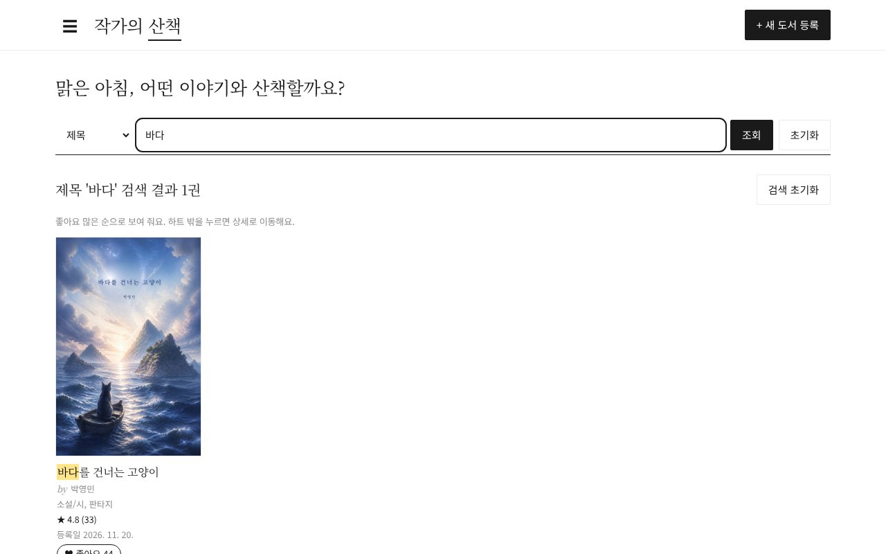
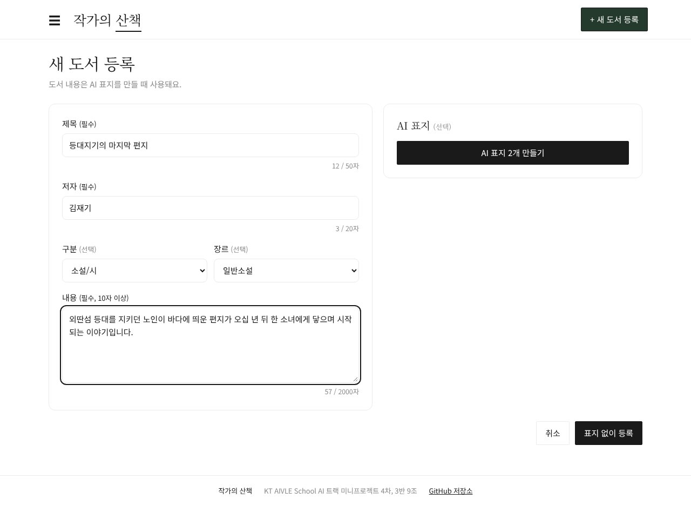
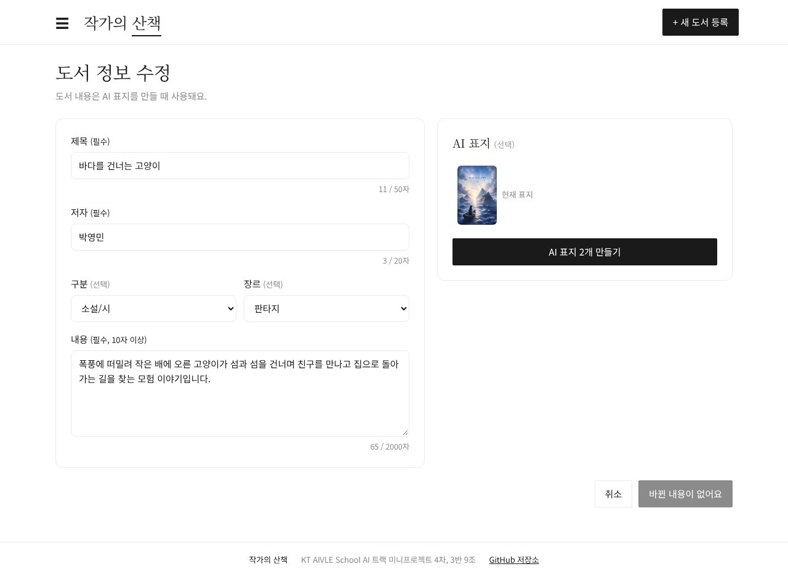
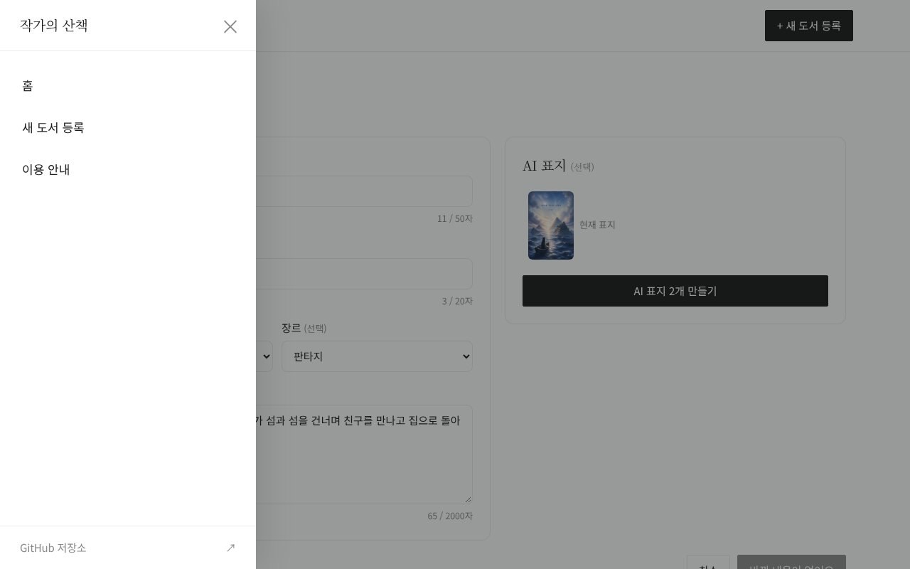
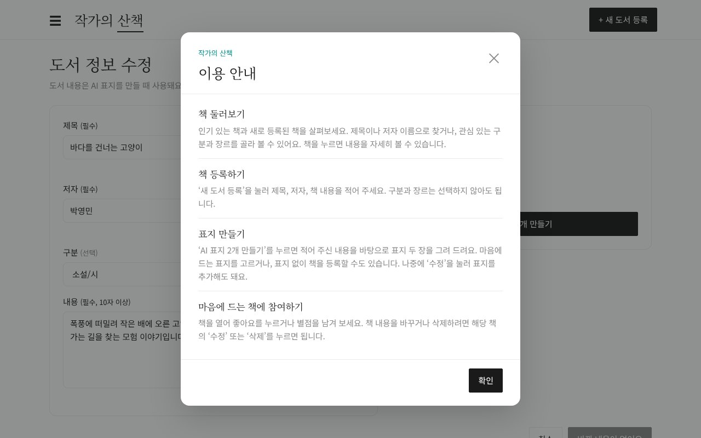

# 작가의 산책 (book_eating_cat)

책을 등록하면 OpenAI 이미지 모델이 내용에 맞는 수채화 표지 후보 2장을 그려 주고, 그중 마음에 드는 1장을 골라 함께 저장하는 도서관리 서비스입니다.

KT AIVLE School AI 트랙 미니프로젝트 4차, 3반 9조

## 주요 기능

| 화면 | 기능 |
|---|---|
| 공통 | 헤더(햄버거 메뉴, 서비스 이름, 새 도서 등록), 햄버거 메뉴(홈, 새 도서 등록, 이용 안내, GitHub), 이용 안내 창, 푸터 |
| 홈 | 시간대별 인사, 제목과 저자 검색(엔터 가능, 검색어 강조), 인기 도서 10권(5권씩 화살표로 넘김), 도서 목록(최신 등록순, 구분 탭과 장르 칩, 5권씩 더 보기), 카드 위에 마우스를 올리면 내용 미리보기, 카드에서 바로 좋아요 |
| 상세 | 경로 표시, 표지, 구분과 장르, 평균 별점과 참여 인원, 별점 주기, 좋아요, 수정, 삭제 확인 |
| 등록, 수정 | 같은 폼 사용, 필수 표시와 칸별 오류 안내, 글자 수 표시, 구분에 따라 바뀌는 장르, AI 표지 2장 생성 후 1장 선택. 수정은 기존 값을 채워 두고 바뀐 칸만 저장 |

## 주요 화면

### 홈
시간대별 인사와 검색창, 좋아요 순 인기 도서 10권을 보여 줍니다.


### 도서 목록
최신 등록순으로 5권씩 보여 주고, 구분 탭과 장르 칩으로 원하는 책만 고를 수 있습니다.


### 카드 내용 미리보기
카드 표지 위에 마우스를 올리면 구분, 장르, 좋아요 수와 책 내용이 나타납니다.


### 검색 결과
제목이나 저자로 찾고, 찾은 글자를 강조해서 보여 줍니다.



### 도서 상세
표지와 책 정보, 별점 주기, 좋아요, 수정, 삭제를 한 화면에서 할 수 있습니다.


### 새 도서 등록
제목, 저자, 내용을 적고 AI 표지 2개 만들기를 누르면 표지 후보 2장이 나오고, 1장을 골라 함께 등록합니다. 표지 없이 등록할 수도 있습니다.



### 도서 정보 수정
기존 내용과 현재 표지를 채운 채로 열리고, 바뀐 칸만 저장합니다. 바뀐 내용이 없으면 저장 버튼이 잠깁니다.



### 햄버거 메뉴와 이용 안내




## 실행 방법

### 1. 준비
- Node.js 20.19 이상 (Vite 8 요구 사항)
- OpenAI API Key (조별 키)

### 2. 설치
```bash
git clone https://github.com/ha-rameter/book_eating_cat.git
cd book_eating_cat
npm install
```

### 3. API Key 설정
프로젝트 폴더에 `.env.local` 파일을 만들고 아래처럼 키를 넣습니다. `.env.example`을 복사해서 이름을 바꿔도 됩니다.

```
OPENAI_API_KEY=조별키
```

- 키는 브라우저가 아니라 json-server가 읽습니다. 그래서 `VITE_`를 붙이지 않습니다.
- `.env.local`은 `.gitignore`에 들어 있어 GitHub에 올라가지 않습니다. 키를 코드에 직접 적지 마세요.

### 4. 실행
터미널 두 개를 열어 각각 실행합니다.

```bash
# 터미널 1: json-server와 표지 생성 서버 (http://localhost:3000)
npm run server

# 터미널 2: React 화면 (http://localhost:5173)
npm run dev
```

브라우저에서 http://localhost:5173 을 엽니다. 키를 바꿨다면 터미널 1을 Ctrl+C로 끄고 `npm run server`를 다시 실행합니다.

### 5. 표지 만들어 보기
1. 오른쪽 위 새 도서 등록을 누릅니다.
2. 제목, 저자, 내용(10자 이상)을 적습니다.
3. AI 표지 2개 만들기를 누르고 잠시 기다립니다. 누를 때마다 2장 분량의 OpenAI 요금이 발생합니다.
4. 후보 2장 중 하나를 고르고 선택한 표지와 함께 등록을 누릅니다.

## 표지 생성 설정

화면에서 고르지 않고 `src/api.js`의 `COVER_SETTINGS`로 고정했습니다.

| 항목 | 값 |
|---|---|
| model | gpt-image-2 |
| n | 2 (후보 2장) |
| size | 1024x1536 (세로) |
| quality | low |
| output_format | png |
| 그림체 | 수채화 기본, 구분과 장르에 따라 분위기 조정 (`src/openai.js`) |

프롬프트는 제목, 저자, 내용, 구분, 장르를 조합해 자동으로 만듭니다.

### 교안과 다르게 설계한 부분

| 교안 | 우리 조 | 이유 |
|---|---|---|
| 상세 화면의 표지 생성 버튼 | 등록과 수정 폼 안에서 표지 생성 | 책을 등록하는 흐름 안에서 표지까지 끝나도록 |
| 화면에서 API Key 입력 | 서버(json-server)의 `.env.local`에서 읽기 | 키가 브라우저 코드와 네트워크 요청에 드러나지 않도록 |
| 모델, 크기 옵션 선택 | 고정값 사용, 후보 2장 중 선택 | 사용자는 고르기만 하면 되도록 단순화 |

## API 명세

| ID | 기능 | 메서드 | 주소 |
|---|---|---|---|
| API-01 | 인기 도서 10권 | GET | /books?_sort=likeCount,review,createdAt&_order=desc,desc,desc&_limit=10 |
| API-02 | 최신 목록 5권씩 | GET | /books?_sort=createdAt&_order=desc&_page=1&_limit=5 |
| API-03 | 제목 검색 | GET | /books?title_like=검색어&_sort=likeCount,createdAt&_order=desc,desc |
| API-04 | 저자 검색 | GET | /books?author_like=검색어&_sort=likeCount,createdAt&_order=desc,desc |
| API-05 | 구분 탭 | GET | API-02에 &category=구분 추가 |
| API-06 | 장르 칩 | GET | API-05에 &genre=장르 추가 |
| API-07 | 상세 | GET | /books/:id |
| API-08 | 등록 | POST | /books |
| API-09 | 수정 (바뀐 항목만) | PATCH | /books/:id |
| API-10 | 좋아요, 취소 | PATCH | /books/:id (likeCount) |
| API-11 | 삭제 | DELETE | /books/:id |
| API-13 | 표지 후보 2장 생성 | POST | /api/covers (json-server가 OpenAI images/generations 호출) |
| API-15 | 별점 주기 | PATCH | /books/:id (review, reviewCount) |

## 데이터 구조 (db.json)

```json
{
  "id": 1,
  "title": "별빛 아래의 서점",
  "author": "홍길동",
  "contents": "도서 내용, AI 표지 프롬프트에 사용",
  "category": "에세이",
  "genre": "일상",
  "coverImageUrl": "처음엔 빈 문자열, 표지를 고르면 Data URL",
  "likeCount": 27,
  "review": 4.3,
  "reviewCount": 15,
  "createdAt": "2026-11-17T09:00:00.000Z",
  "updatedAt": "2026-11-17T09:00:00.000Z"
}
```

- review는 다른 사용자가 준 별점의 평균, reviewCount는 참여 인원입니다. 등록하는 사람은 별점을 정하지 않습니다.
- 좋아요와 별점은 updatedAt을 바꾸지 않습니다.

## 폴더 구조

```
book_eating_cat/
├── server/covers.cjs        표지 생성 서버 (json-server 미들웨어, /api/covers)
├── db.json                  도서 데이터
├── docs/screenshots/        README 화면 캡처
└── src/
    ├── App.jsx              화면 전환, 등록, 수정, 삭제, 좋아요, 별점 처리
    ├── App.css              색 변수와 공통 디자인
    ├── api.js               API 주소, fetch 함수, 표지 고정 설정
    ├── openai.js            프롬프트 구성, OpenAI 호출, Data URL 변환
    ├── constants.js         서비스 정보, 구분과 장르 목록, 입력 제한
    └── components/
        ├── layout/          Header, HamburgerMenu, ServiceGuideModal, Footer
        ├── common/          ConfirmModal
        └── pages/
            ├── main/        HomePage, SearchBar, SearchResult, CategoryFilter,
            │                PopularBooks, BookList, BookCard, StateBox
            ├── detail/      BookDetail, LikeButton, StarRating
            └── form/        BookForm, CoverPicker
```

## 역할 분담

| 이름 | 담당 |
|---|---|
| 정하람 | App, Header, HamburgerMenu, ServiceGuideModal, 통합과 머지 |
| 김재기 | SearchBar, CategoryFilter, SearchResult, BookCard, StateBox, PopularBooks, BookList, HomePage, Footer, 전체 디자인(CSS) |
| 고승현 | BookDetail, LikeButton, StarRating |
| 양경모 | BookForm, CoverPicker, 표지 생성 서버(covers.cjs), openai.js |

## 참고 사항

- 로그인이 없어서 좋아요와 별점은 새로고침하면 다시 누를 수 있습니다.
- 표지는 Data URL로 db.json에 저장되어 한 장에 수 MB까지 커질 수 있습니다.
